<div align="center">


# Volteo

**La recharge de véhicules électriques en Tunisie, depuis votre téléphone.**

Plateforme SaaS multi-stations · application mobile iOS & Android · back-office web · bornes pilotées en OCPP 1.6J


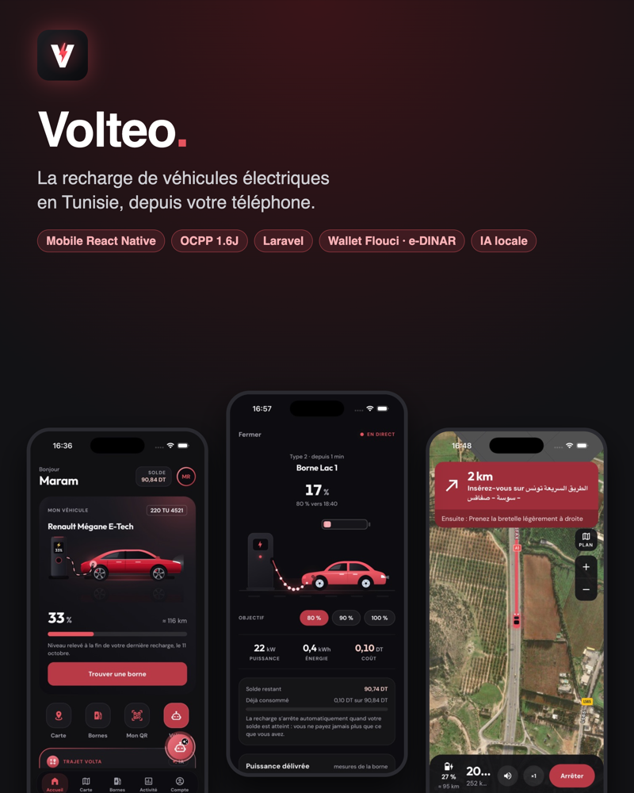

</div>

---

## ✨ En bref

Volteo réunit en une seule plateforme les trois acteurs de la recharge :

| | Pour qui | Ce qu'il peut faire |
|---|---|---|
| 📱 | **Le conducteur** (application mobile) | Trouver une borne libre, démarrer une recharge par **QR code**, appli ou **badge RFID**, suivre la recharge en direct, payer avec un **wallet prépayé** (Flouci, e-DINAR, carte bancaire), planifier un trajet et se laisser guider |
| 🏢 | **L'administrateur de station** | Superviser et commander **ses** bornes à distance, fixer ses tarifs, suivre ses clients, son chiffre d'affaires et sa part nette |
| 🛡️ | **Le super-administrateur** | Ajouter et suspendre des stations clientes, fixer leur formule et la commission, superviser tout le réseau, communiquer avec les stations |

## 📱 Application mobile

<table>
<tr>
<td align="center">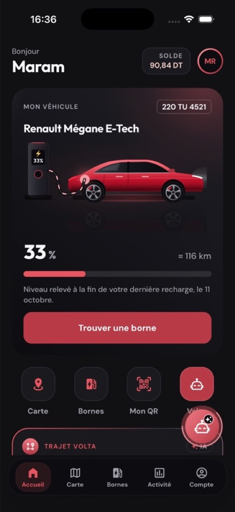<br/><sub>Accueil : véhicule, batterie, wallet</sub></td>
<td align="center">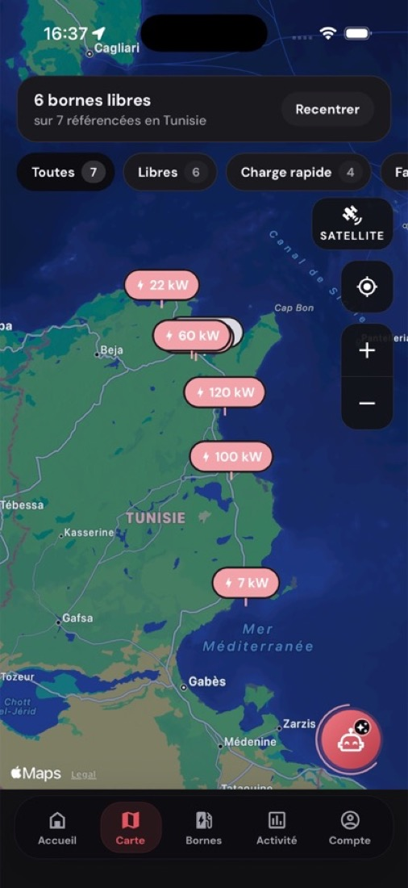<br/><sub>Carte native des bornes</sub></td>
<td align="center">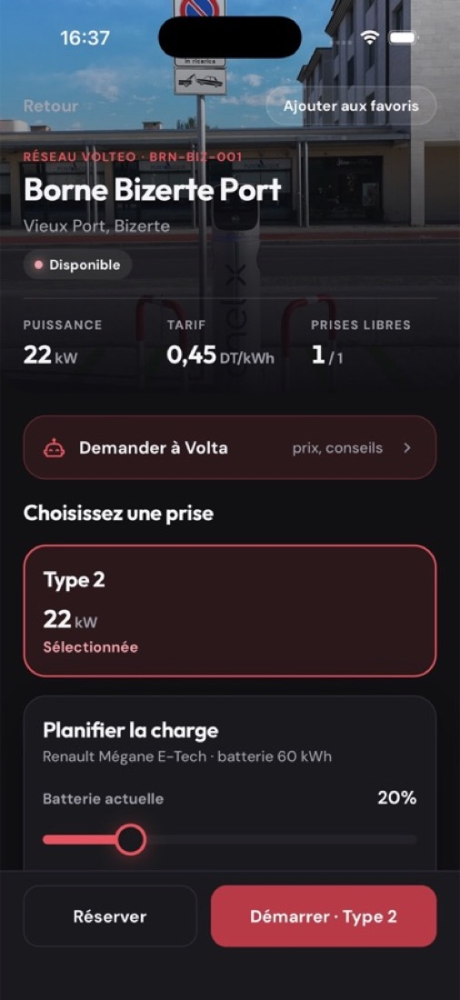<br/><sub>Fiche borne et planification</sub></td>
<td align="center">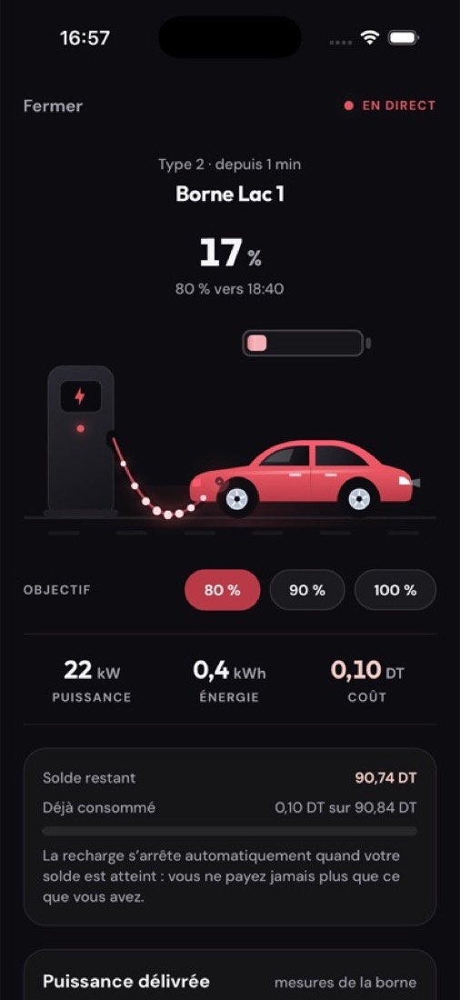<br/><sub>Recharge en direct</sub></td>
</tr>
<tr>
<td align="center">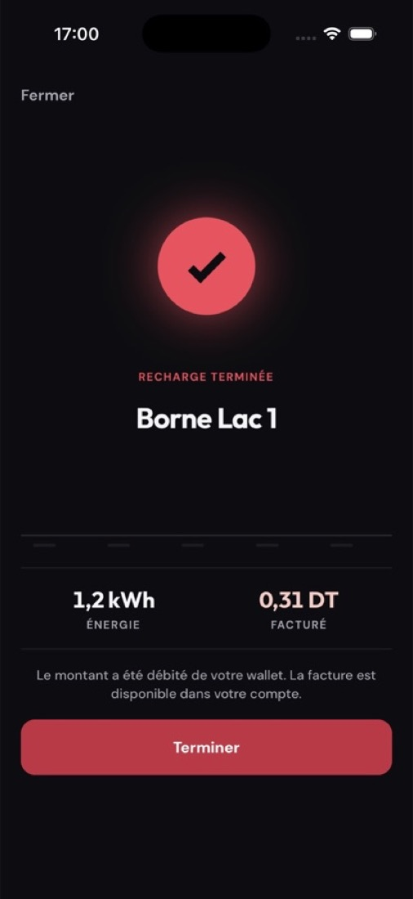<br/><sub>Fin : prix exact débité</sub></td>
<td align="center">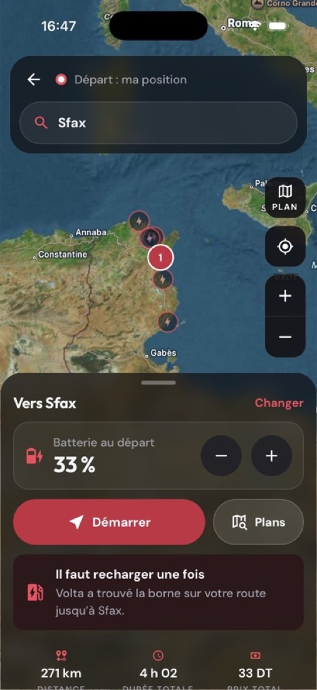<br/><sub>Trajet Volta : arrêts calculés</sub></td>
<td align="center">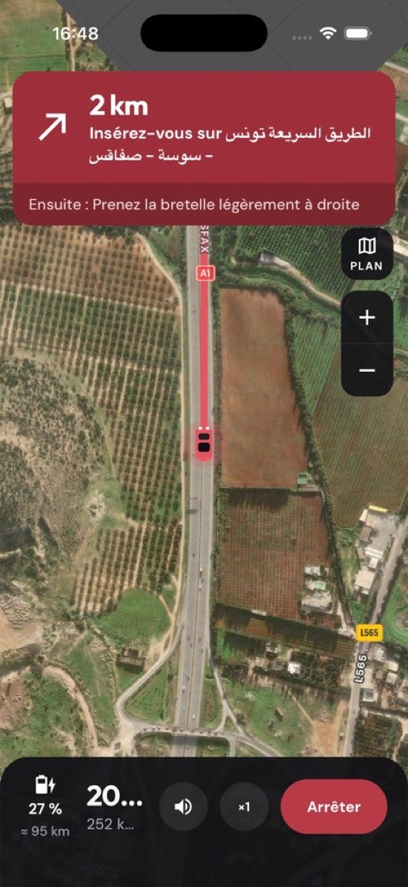<br/><sub>Mode conduite guidé</sub></td>
<td align="center">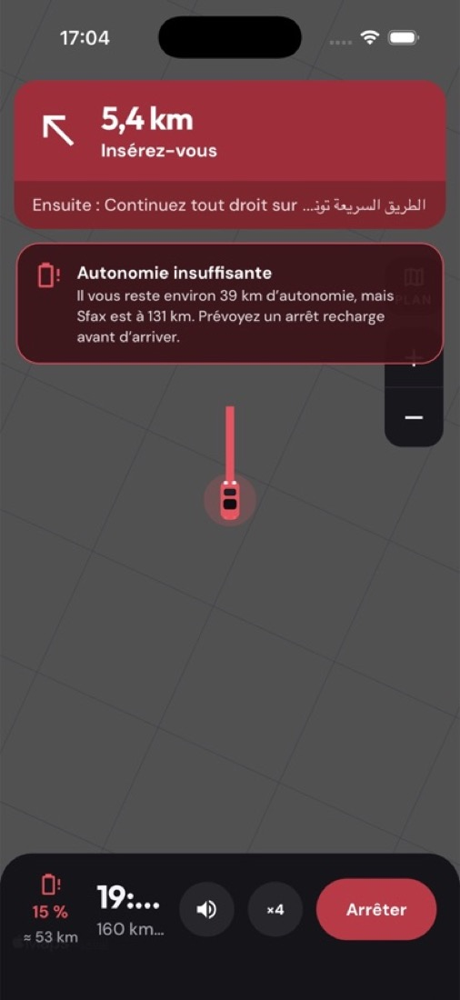<br/><sub>Alerte vocale d'autonomie</sub></td>
</tr>
<tr>
<td align="center">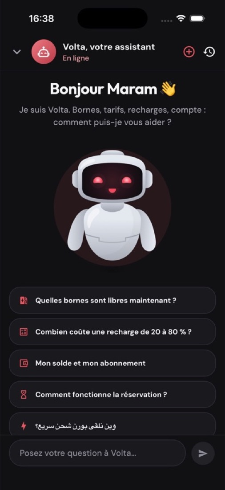<br/><sub>Assistant IA Volta</sub></td>
<td align="center">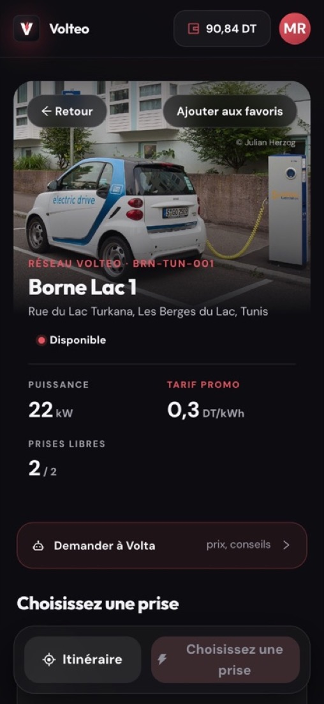<br/><sub>Borne ouverte par QR code</sub></td>
<td></td><td></td>
</tr>
</table>

## 🖥️ Back-office et espace client web

| Super-admin : stations clientes | Bornes du réseau |
|---|---|
| 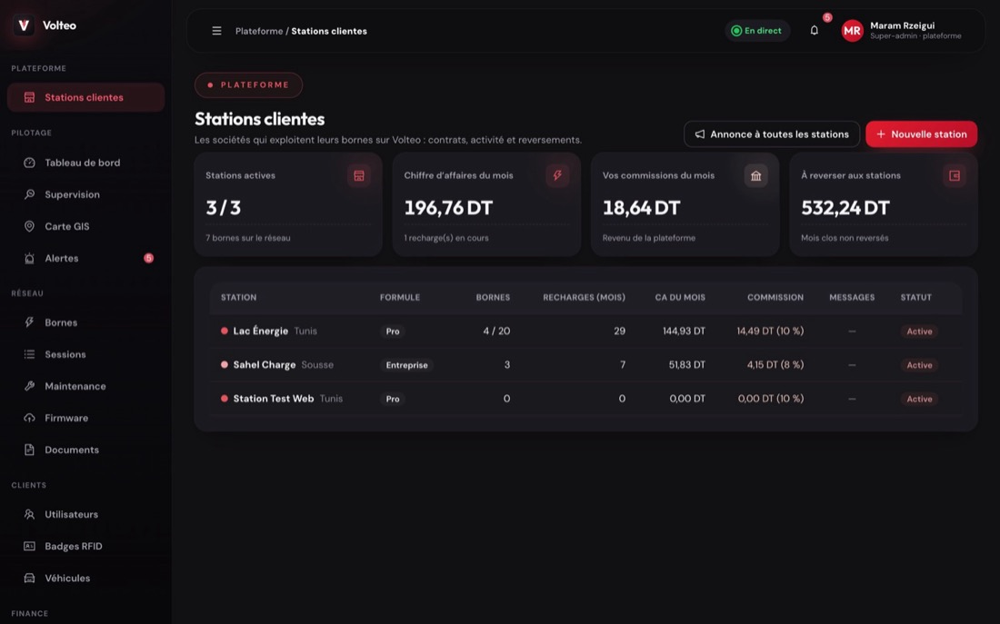 | 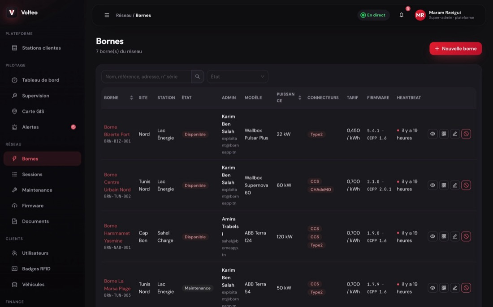 |
| **Admin de station : recharges en direct** | **Fiche borne et commandes OCPP** |
| 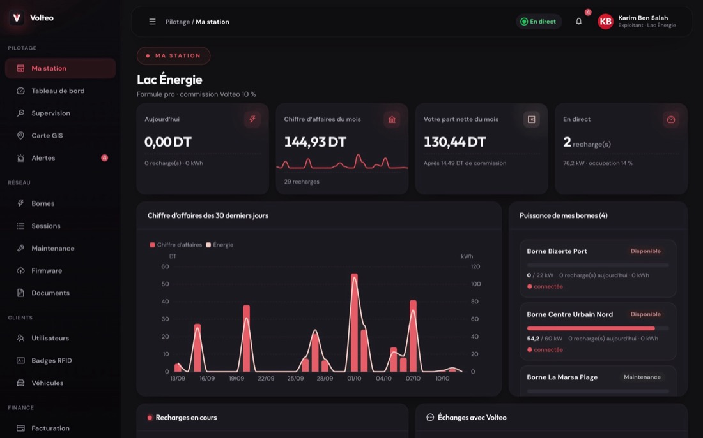 | 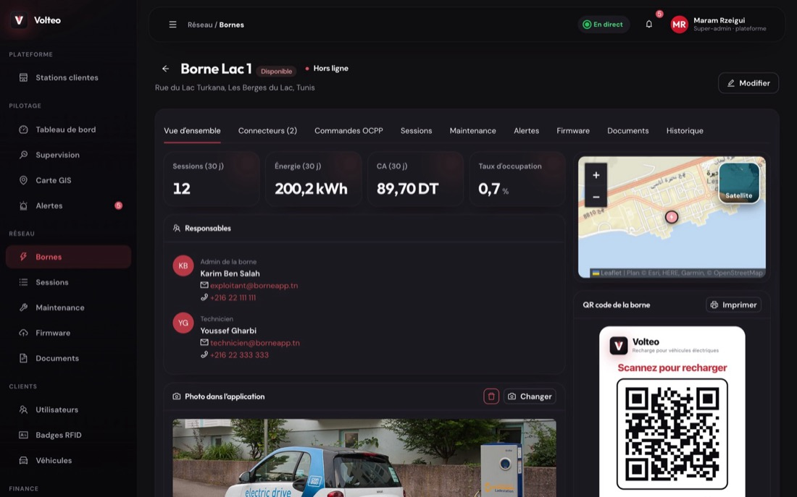 |
| **Trajet Volta : Tunis → Sfax** | **Assistant Volta (IA locale)** |
| 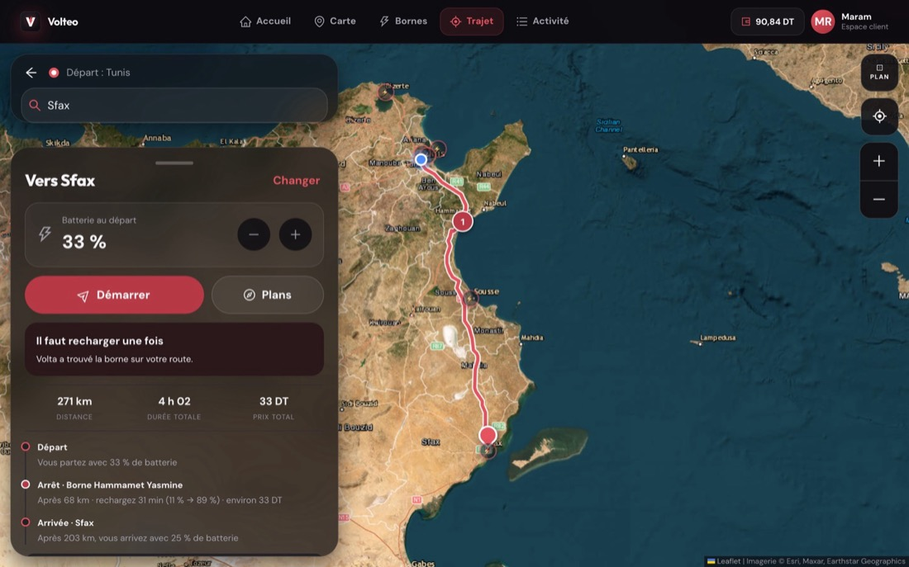 | 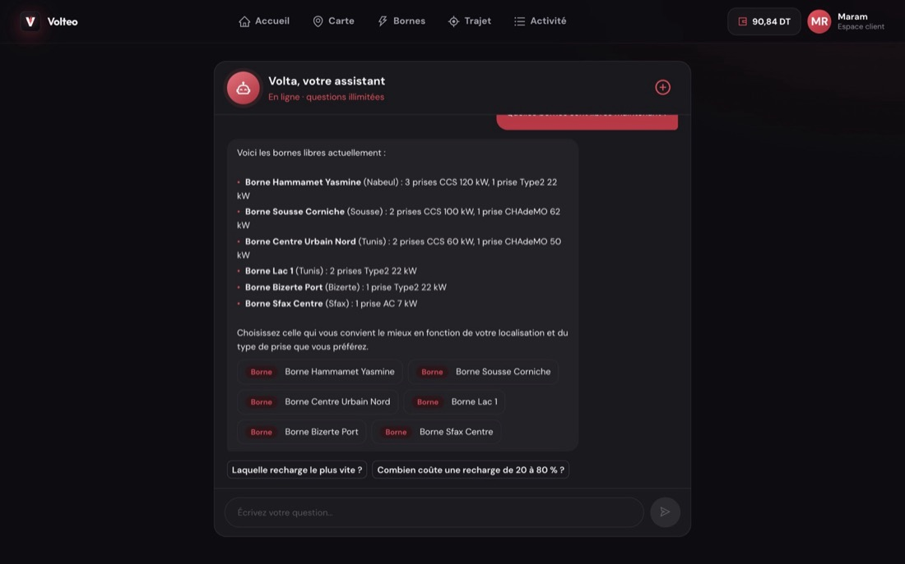 |
| **Étiquette QR imprimable** | **Recharge du wallet** |
| 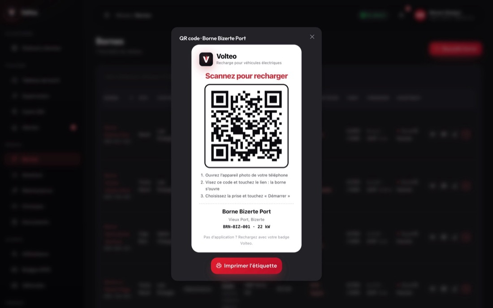 | 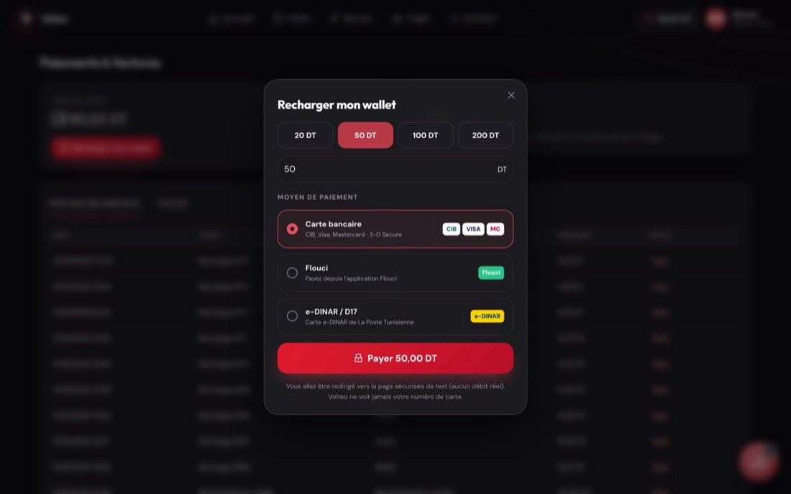 |

## 🧩 Fonctionnalités clés

- **Bornes réelles en OCPP 1.6J** : serveur central Node.js (BootNotification, Authorize, Start/StopTransaction, MeterValues…), commandes à distance, journal des trames. Validé avec le simulateur open source de SAP.
- **Wallet prépayé au solde exact** : solde minimum pour démarrer, prix recalculé à chaque mesure, arrêt automatique quand le solde est atteint, jamais de solde négatif.
- **Paiements tunisiens** : ClicToPay (cartes), Flouci et Konnect (e-DINAR), avec vérification systématique auprès du prestataire.
- **SaaS multi-stations** : chaque station ne voit que ses données, isolation garantie côté serveur.
- **QR code par borne** : un simple lien web, lisible par n'importe quel téléphone, avec ou sans l'application.
- **IA locale** : assistant Volta (Ollama + Qwen 2.5, appel d'outils) et planificateur de trajet avec alertes vocales.
- **Temps réel partout** : puissance, énergie, coût et solde mis à jour en direct sur mobile et web.

## 🏗️ Architecture

```
 Application mobile (React Native / Expo)      Application web (React + Vite)
                 \                                   /
                  \______ HTTPS / JSON _____________/
                                 |
                     API Laravel 13 (cœur métier)  ──── MySQL
                      |            |          \
             passerelles     Ollama (IA)    commandes / événements
             de paiement                         |
                                      Serveur central OCPP (Node.js)
                                                 |  OCPP 1.6J (WebSocket)
                                      Bornes de recharge (ou simulateur SAP)
```

| Dossier | Contenu |
|---|---|
| `app/`, `components/`, `lib/` | Application mobile (Expo Router) |
| `backend/` | API Laravel : bornes, recharges, wallet, paiements, stations, IA |
| `backoffice/` | Application web : back-office et espace client |
| `ocpp-server/` | Système central OCPP 1.6J et relais temps réel |

## 🚀 Lancer le projet

```bash
# 1. API
cd backend && composer install && cp .env.example .env && php artisan key:generate
php artisan migrate --seed && php artisan serve

# 2. Serveur OCPP
cd ocpp-server && npm install && node server.js

# 3. Application web
cd backoffice && npm install && npm run dev

# 4. Application mobile
npm install && npx expo start
```

## 👩‍💻 Auteure

**Maram Rzeigui**, élève ingénieure à ESPRIT, spécialité Systèmes d'Information Mobile (SIM).
[LinkedIn](https://www.linkedin.com/in/maram-rzeigui/) · [GitHub](https://github.com/maramrzeigui)
